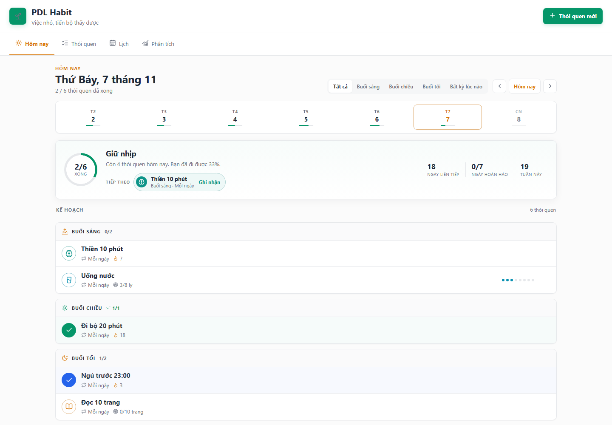
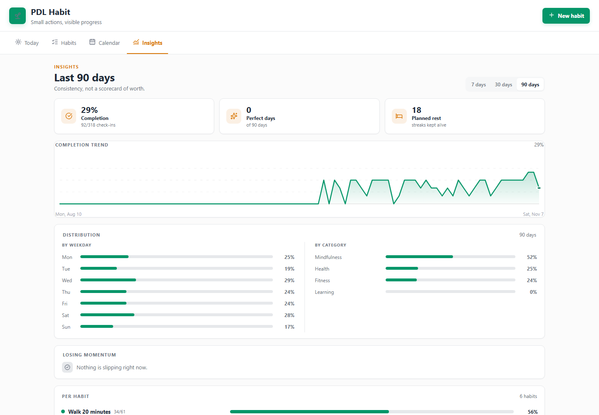
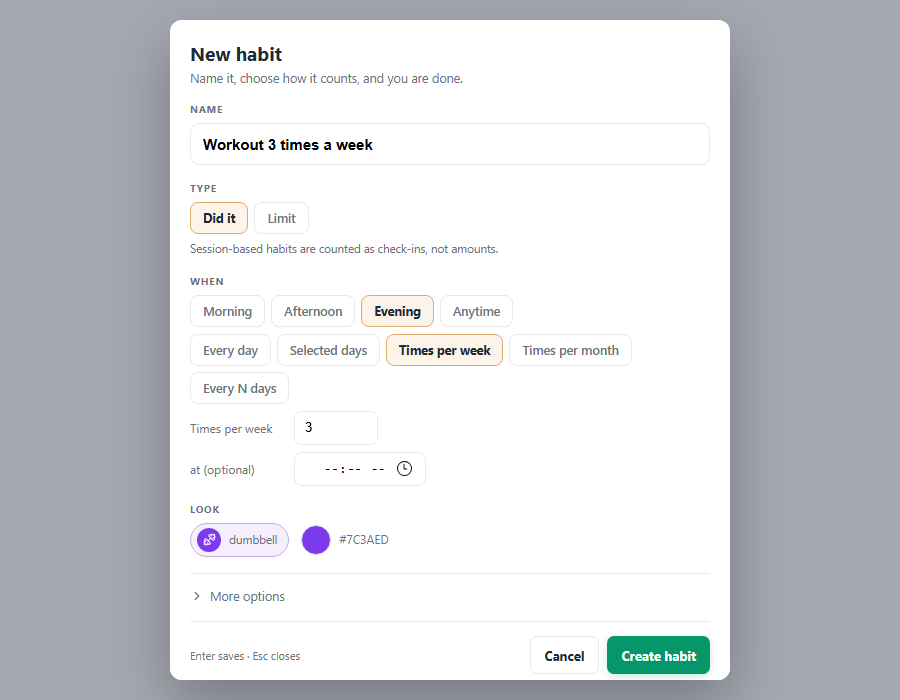
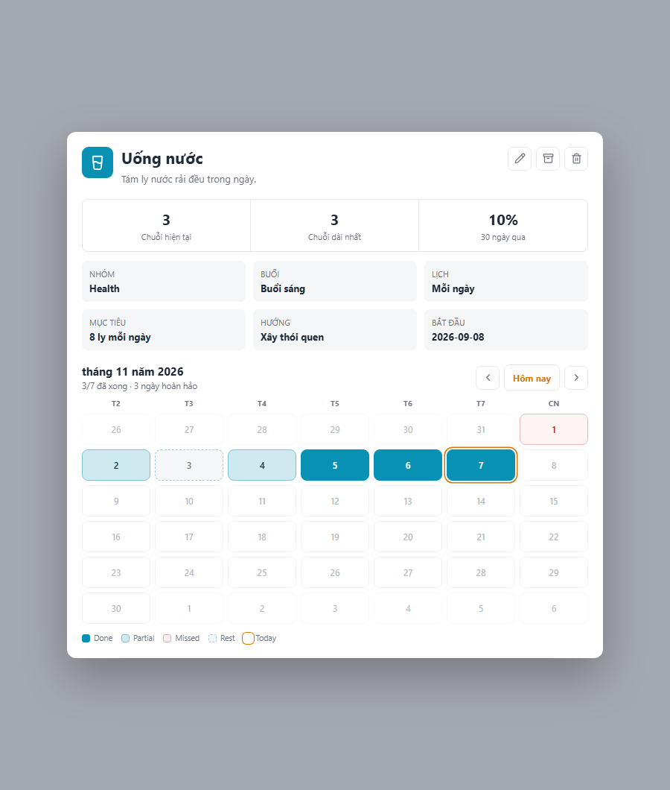
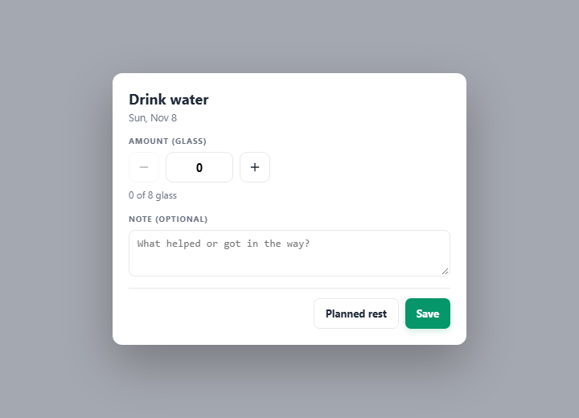

# PDL Habit

**A calm, Markdown-first habit tracker for [Obsidian](https://obsidian.md).**

Every habit is a plain note; every check-in is one line of frontmatter. Nothing is
locked inside the plugin, and the whole thing works offline.



> **Version 1.0.0** · Obsidian **1.5.0+** · desktop and mobile · English / Tiếng Việt

## Why another habit tracker?

- **Your notes stay yours.** A habit is `<folder>/Uống nước.md` with frontmatter — no
  database, no sync service.
- **Four tabs, one job each.** Today for doing, Habits for finding, Calendar for
  seeing, Insights for noticing.
- **Quiet by default.** No points, no badges, no guilt. Progress is shown as a ring,
  a streak and a month calendar.

## Highlights

**Capture**
- Compact habit form: name it, pick *Did it / Count / Limit*, choose when — done.
  Everything optional hides behind **More options**, and Enter saves.
- **Five schedules**: daily, selected weekdays, times per week, times per month,
  every N days, plus an optional exact time of day.
- Build or limit: grow a behaviour or cap one you want less of.

**Check in**
- Counted habits start at **0** with − / + buttons and a live `0 of 3 ly` hint;
  binary habits get a Done / Not done switch instead of a meaningless amount.
- **Undo anything** — every check-in, planned rest and clear raises a toast with
  **Undo** for eight seconds that restores the previous frontmatter exactly.
- **Planned rest** never breaks a streak.

**Review**
- **Habit detail with a month calendar** — one month at a time with ‹ Today ›
  navigation, five colour-coded states and a legend; tap any day to fix that day.
- **Insights with a 7 / 30 / 90-day range** — completion trend line, weekday and
  category breakdowns, and habits that are losing momentum.

**Find & tidy**
- Search, category filter and sort (title, streak, 30-day rate, category) over a list
  of tappable seven-day cells; **Active / Archived** is a switch, not a tab.
- **Any colour, 171 icons** in ten groups with search; dark mode throughout.

**Shortcuts & language**
- Command palette: **Quick add** (name + Enter), **Open a day**, **Undo last
  check-in**, **Add starter habits**.
- **English or Tiếng Việt** — a language setting translates the whole interface;
  *Auto* follows Obsidian.



## Install

### Manual (works today)

1. Download `main.js`, `manifest.json` and `styles.css` from the
   [latest release](https://github.com/LuongPham16/pdl-habit/releases/latest).
2. Put them in `<vault>/.obsidian/plugins/pdl-habit/`.
3. Enable **PDL Habit** in *Settings → Community plugins*.

### From source

```bash
git clone https://github.com/LuongPham16/pdl-habit.git
cd pdl-habit
npm install
npm run build:prod
```

Then copy `dist/main.js`, `dist/styles.css` and the root `manifest.json` into
`<vault>/.obsidian/plugins/pdl-habit/`.

## Quick start

1. Click the sprout ribbon icon, or run **PDL Habit: Open habit dashboard**.
2. Press **New habit** — or **Add starter habits** for a five-habit starter set.
3. Tap the circle beside a habit to check in; counted habits open a small sheet for
   the amount, a note or a planned rest.

Notes live in `03 - Area/Habits` by default; change the folder in settings.

## What a habit note looks like

```yaml
---
type: habit
title: Uống nước
period: morning          # morning | afternoon | evening | anytime
time: "07:30"            # optional exact time
frequency: daily         # daily | weekdays | weekly | monthly | interval
days: [1, 3, 5]          # weekdays, when frequency is weekdays
target: 8
unit: ly
direction: build         # build | quit
icon: glass-water
color: "#0891b2"
start_date: 2026-01-01
history:
  2026-11-07: { value: 4, note: "hot day" }
  2026-11-06: { value: 0, status: skip }   # planned rest
---
```

## Screenshots

| Habit form | Month calendar | Check-in |
|---|---|---|
|  |  |  |

## Development

```bash
npm install
npm run dev        # rebuild dist/main.js on change
npm run build:prod # minified build
npm test           # unit tests (scheduling, completion, streaks, aggregates, i18n)
npm run verify     # load the built bundle against a stubbed Obsidian API
npm run preview    # render every tab offline into preview/*.png
npm run deploy     # build + copy into the vault listed in .deploy.json
```

Copy `.deploy.example.json` to `.deploy.json` and point it at your vault to use
`npm run deploy`.

## Project layout

```
src/
  index.js       bundle entry
  plugin.js      lifecycle, note scanning, persistence, reminders, undo, commands
  view.js        the four tabs — Today, Habits, Calendar, Insights
  ui.js          page header, segmented control, cards, empty states, toast
  habits.js      scheduling, completion, streaks, aggregates, search/sort, insights
  habit-form.js  draft model behind the habit form
  starters.js    five starter habits for a new vault
  i18n.js        English/Vietnamese dictionary, t()/tp(), locale helpers
  reminders.js   reminder window + message (pure, testable)
  dates.js       date and string helpers
  constants.js   ids, palette, icon catalogue
  dom.js         small DOM helpers
  modals/        habit form, icon picker, check-in, detail, confirm, quick add, day picker
  settings.js    settings tab (folder, week start, default view, language, reminders)
styles.css       base sheets, page frame, tabs, toolbar, toast and modals
preview/         offline renderer used for design review
tests/           node:test suites
```

## License

[MIT](LICENSE) © 2026 Luong Pham
